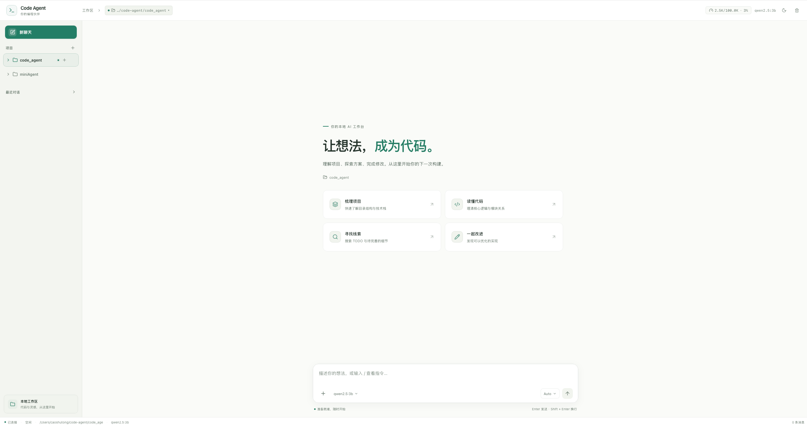

# Code Agent

<p align="center">
  <strong>本地运行的 AI 编程工作台</strong><br />
  选择你的代码目录，用自然语言理解、搜索和修改项目。
</p>
<p align="center">
  <a href="https://github.com/sun-mine/my_code_agent"></a>
  
  
  
  
  
  
  
  
</p>


Code Agent 将对话、项目目录和代码工具放在同一个界面中。项目目录由你明确选择；之后可以在项目下创建多个对话，让智能体围绕当前项目读取代码、解释结构、搜索内容或执行修改。

## 技术栈

| 部分 | 技术 | 用途 |
| --- | --- | --- |
| 后端语言 | Python 3.10+ | Agent 主循环、工具执行和服务端业务逻辑 |
| Web 服务 | Flask、Flask-CORS | 提供 HTTP API，并处理跨域配置 |
| 实时通信 | Flask-SocketIO、python-socketio、Socket.IO Client | 推送流式回复、工具调用和运行状态 |
| Agent 与模型接口 | Anthropic Python SDK、Anthropic Messages API 兼容服务 | 组织模型请求和工具调用；默认连接 Ollama |
| 前端语言 | TypeScript 6、React 19 | 构建类型安全的交互式工作台 |
| 前端构建 | Vite 8、`@vitejs/plugin-react` | 本地开发服务器和生产构建 |
| UI 与样式 | Tailwind CSS 4、Lucide React | 样式工具与图标 |
| 前端数据 | TanStack Query、React Hooks | 请求缓存、界面状态和异步数据管理 |
| Markdown 与代码 | React Markdown、remark-gfm、Shiki | 渲染 Markdown、GFM 和代码高亮 |
| 默认模型服务 | Ollama（`qwen2.5:3b`） | 在本机运行模型；也可切换到兼容 Anthropic API 的服务 |

Python 依赖位于 `requirements.txt`；前端依赖和版本锁定分别位于 `frontend/package.json` 与 `frontend/package-lock.json`。

## 界面预览



## 功能

- **项目工作区**：通过文件夹选择器逐级浏览并添加现有目录，也可创建文件夹或空文件。
- **项目内多对话**：每个项目可以拥有多个独立会话；从项目下新建对话时，智能体使用该项目作为工作目录。
- **自然语言理解代码**：询问“当前目录是什么”“解释这段代码”“分析项目结构”或“查找某个 TODO”，智能体会结合所选目录工作。
- **实时执行反馈**：通过 Socket.IO 流式显示回复、思考过程及工具调用，并可中断当前运行。
- **灵活执行模式**：Plan 用于先审阅计划，Auto 用于自动执行，Manual 用于在写入或命令等操作前请求审批。
- **代码工具**：读取、搜索、创建和编辑文件，运行终端命令，并在界面中查看文件内容和变更。
- **任务协作**：提供任务看板、Todo、多 Agent 状态、记忆和上下文压缩等能力。
- **主题切换**：支持明亮和暗色界面。

从侧栏移除项目只会从当前浏览器的项目列表中取消登记，不会删除磁盘上的项目目录。

## 工作方式

```text
浏览器（React + TypeScript）
        │ HTTP API：状态、项目文件、会话
        │ Socket.IO：实时对话与工具事件
        ▼
Flask + Flask-SocketIO（api_server.py）
        ▼
AgentLoop（core/loop.py） ── 工具（tools/）与组件（components/）
        ▼
兼容 Anthropic Messages API 的模型服务
```

后端默认连接本机 Ollama，模型为 `qwen2.5:3b`。也可以通过环境变量切换到其他兼容 Anthropic Messages API 的服务。

## 环境要求

- Python 3.10 或更高版本
- Node.js 20.19+ 或 22.12+
- 一个兼容 Anthropic Messages API 的模型服务；推荐本机 Ollama

## 安装

在仓库根目录执行：

```bash
# 可选：创建并启用虚拟环境
python3 -m venv .venv
source .venv/bin/activate

# 安装后端依赖
pip install -r requirements.txt

# 安装前端依赖
cd frontend
npm install
cd ..
```

### 配置 Ollama

安装 Ollama 后，下载默认模型并启动服务：

```bash
ollama pull qwen2.5:3b
ollama serve
```

Ollama 默认监听 `http://127.0.0.1:11434`。如果模型服务已在其他终端或服务中运行，无需重复启动。

## 本地启动

```bash
./start.sh
```

启动后访问：

| 服务 | 地址 |
| --- | --- |
| Web 工作台 | <http://localhost:5173> |
| 后端 API | <http://localhost:8000> |

也可以分别启动后端和前端，便于查看各自日志：

```bash
# 终端一：仓库根目录
python3 api_server.py

# 终端二：仓库根目录
cd frontend
npm run dev
```

开发模式下，Vite 会将 `/api` 请求代理到 `localhost:8000`；Socket.IO 直接连接后端。

## 选择项目并开始对话

1. 在左侧“项目”区域点击 **+**，打开文件夹选择器。
2. 在目录列表中逐级打开文件夹，使用“上一级”返回；也可以先创建新文件夹。
3. 选中要作为项目根目录的文件夹并确认。
4. 点击项目旁的 **+** 创建项目对话。
5. 直接提问，例如“当前目录是哪个？”或“解释这个项目的入口文件”。智能体会基于已选目录回答并在其中使用代码工具。

项目列表保存在浏览器本地存储中。会话、记忆、任务和安全快照等运行数据保存在所选工作目录的 `.agent/` 下。切换项目会切换智能体的工作目录。

## 模型配置

后端读取以下环境变量，也可以在仓库根目录创建 `.env` 文件设置：

| 变量 | 默认值 | 用途 |
| --- | --- | --- |
| `AGENT_WORKDIR` | 启动时的当前目录 | 后端初始工作目录 |
| `ANTHROPIC_BASE_URL` | `http://127.0.0.1:11434` | 模型服务地址 |
| `ANTHROPIC_AUTH_TOKEN` | `ollama` | 模型服务 API Key |
| `MODEL_ID` | `qwen2.5:3b` | 模型名称 |
| `TOKEN_THRESHOLD` | `100000` | 自动压缩上下文的 token 阈值 |

例如，使用 Anthropic API 时可配置：

```dotenv
ANTHROPIC_BASE_URL=https://api.anthropic.com
ANTHROPIC_AUTH_TOKEN=your-api-key
MODEL_ID=claude-sonnet-4-20250514
```

请勿将包含真实密钥的 `.env` 提交到版本库。模型也可以在界面中切换（取决于后端服务提供的模型列表）。

## 部署

### 单机部署

单机使用时，可按“安装”章节安装依赖，并在 Ollama 或其他模型服务就绪后运行：

```bash
./start.sh
```

这会启动 Flask-SocketIO 后端和 Vite 前端开发服务器。适合本机使用和开发调试。

### 构建前端

部署静态前端前，在仓库根目录执行：

```bash
cd frontend
npm ci
npm run build
```

构建结果位于 `frontend/dist/`。将此目录部署到静态文件服务器，并将 `/api/` 与 `/socket.io/` 反向代理到运行在 `8000` 端口的后端。示例 Nginx 配置如下，需将静态目录改成服务器上的实际路径：

```nginx
server {
    listen 80;
    server_name your-domain.example;
    root /var/www/code-agent;
    index index.html;

    location / {
        try_files $uri $uri/ /index.html;
    }

    location /api/ {
        proxy_pass http://127.0.0.1:8000;
        proxy_set_header Host $host;
        proxy_set_header X-Real-IP $remote_addr;
    }

    location /socket.io/ {
        proxy_pass http://127.0.0.1:8000/socket.io/;
        proxy_http_version 1.1;
        proxy_buffering off;
        proxy_set_header Upgrade $http_upgrade;
        proxy_set_header Connection "upgrade";
        proxy_set_header Host $host;
    }
}
```

将 `frontend/dist` 的内容复制到 `/var/www/code-agent` 后启动后端：

```bash
cd /path/to/code_agent
AGENT_WORKDIR=/path/to/your/project \
ANTHROPIC_BASE_URL=http://127.0.0.1:11434 \
MODEL_ID=qwen2.5:3b \
python3 api_server.py
```

后端的 `AGENT_WORKDIR` 是初始工作目录；用户仍可在界面中选择其他项目。当前后端状态和 Socket.IO Agent 实例保存在单个进程内，部署时请使用单个后端进程，并确保前端和 API/Socket.IO 使用同一站点来源。面向公网使用时，应在反向代理层启用 HTTPS，并自行配置访问控制。

## 主要目录

```text
.
├── agent.py                 # 命令行入口
├── api_server.py            # Flask API 与 Socket.IO 服务
├── start.sh                 # 本地启动脚本
├── core/
│   ├── loop.py              # Agent 主循环与工具执行
│   └── subagent.py          # 子 Agent
├── components/              # 配置、记忆、任务、安全与团队管理
├── tools/                   # 文件、命令、任务等 Agent 工具
└── frontend/
    └── src/
        ├── App.tsx          # 主界面
        ├── components/      # 侧栏、文件选择、聊天和各功能面板
        ├── hooks/           # 对话与 Socket.IO hooks
        └── lib/             # API、类型、主题与工具函数
```

## API 概览

| 方法 | 路径 | 说明 |
| --- | --- | --- |
| `GET` | `/api/status` | Agent 状态与当前工作目录 |
| `POST` | `/api/chat` | 发起对话请求 |
| `POST` | `/api/chat/interrupt` | 中断当前运行 |
| `GET` / `DELETE` | `/api/history` | 读取或清空当前历史 |
| `GET` / `POST` | `/api/sessions` | 列出或保存会话 |
| `DELETE` | `/api/sessions/<sid>` | 删除会话 |
| `GET` / `POST` | `/api/workdir` | 获取或切换工作目录 |
| `GET` | `/api/fs/ls` | 浏览服务器可访问的文件夹 |
| `POST` | `/api/fs/mkdir` | 创建文件夹 |
| `POST` | `/api/fs/touch` | 创建空文件 |
| `GET` | `/api/files/tree` | 获取项目文件树 |
| `GET` / `PUT` | `/api/files/content` | 读取或保存文件 |

实时对话及工具执行事件通过 Socket.IO 的 `agent_event` 事件推送。具体可用路由以 `api_server.py` 当前实现为准。

## 开发检查

```bash
cd frontend
npm run lint
npm run build
```

后端依赖可通过 `pip install -r requirements.txt` 安装；启动服务可检查基础初始化和模型连接配置。

## 常见问题

| 现象 | 排查方法 |
| --- | --- |
| 页面显示未连接 | 确认后端在 `8000` 端口运行；部署环境还需确认 `/socket.io/` 已正确代理。 |
| 模型不可用 | 检查模型服务地址、模型名称，并确认 Ollama 已下载对应模型。 |
| 智能体读取了错误目录 | 在顶部工作目录或侧栏确认当前项目，再在目标项目下新建对话。 |
| 创建文件夹或文件失败 | 确认目标路径存在且后端进程对该目录有写入权限。 |
| 新 API 返回 404 | 重启 Python 后端，使其加载最新路由。 |
| 移除项目后文件仍存在 | 这是预期行为：移除只清理浏览器中的项目登记，不会删除磁盘内容。 |

## License

MIT
