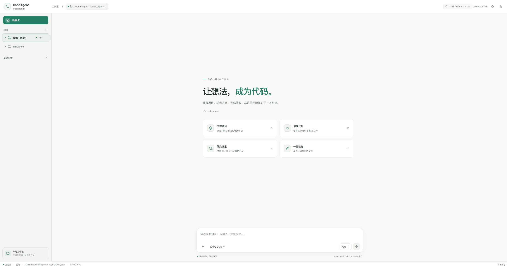

# Code Agent

<p align="center">
  <strong>测试驱动、交付可复验的 AI 编程工作台</strong><br />
  定位代码 → 修改 → 执行验证 → 根据失败反馈修复 → 审阅真实 diff 与执行记录。
</p>
<p align="center">
  <a href="https://github.com/sun-mine/my_code_agent"></a>
  
  
  
  
  
  
  
  
</p>


Code Agent 面向本地代码仓库的理解与修复。保留一个自研工具调用循环，以独立的代码定位工具、交付报告和评测脚本验证工程设计的价值。

## 核心能力与验证

| 能力 | 实现 | 可检查的证据 |
| --- | --- | --- |
| Python 代码定位 | AST 提取定义与 import，文本匹配引用候选，返回文件与行号 | `lookup_symbol` 工具结果；引用候选不等于调用图 |
| 测试驱动修复 | 显式配置验证命令，失败后最多两轮修复；统一限制模型轮数、工具次数、耗时与 Token | 实际命令退出码、修复轮数及预算终态 |
| 可复核交付 | 捕获运行前 Git 基线，运行后生成文件清单、diff 和命令记录 | 每个项目的 `.agent/runs/<run_id>/report.json` 与 `events.jsonl` |
| 可靠会话执行 | 请求幂等、运行归属、进程级取消、重连后快照恢复 | 后端与前端回归测试 |
| 可复现评测 | 固定题集、开发/留出划分、同模型同预算比较 | [评测说明](evals/README.md)及逐题原始结果 |

**评测结果边界：** 软件测试与离线回放验证执行和评分链路；真实模型任务完成率需要单独实测。自建题集不代表 SWE-bench 成绩，也不宣称通用领先。

已有[本地免费模型的小样本对照与失败分析](evals/results/free-local-smoke/comparison.md)。该样本尚未证明检索或修复策略能提升任务完成率，真实仓库成绩仍待测。

无需模型即可复现评分链路：

```bash
python3 -m evals.runner --split all --run-name offline-demo --output evals/results/offline-demo
```

题集包含 20 个自建 Python 修复小题，固定为 12 个开发题与 8 个留出题。离线演示回放预置补丁，输出逐题 JSONL 和汇总 Markdown，不计为 Agent 成功率。[真实本地 Git 仓库任务接入](evals/repo_manifest.example.json)支持固定 base commit、问题描述、公开验证命令和外部验收脚本；模型完成率在显式 `--live` 运行后才产生。

## 修复工作流

默认仍支持普通代码对话。需要自动验证时，在启动后端前为所选项目显式设置命令：

```bash
export AGENT_VERIFY_COMMAND='python3 -m pytest -q'
./start.sh
```

在 Auto 模式下，模型结束一轮修复后，控制器执行该命令；失败日志返回给 Agent，最多进行两轮后续修复。Manual 模式仍需审批命令，Plan 模式不执行验证。验证命令应适用于当前选中的工作目录；切换项目时需要相应调整配置并重启后端。

聊天中的交付报告可展开真实 diff 与命令日志、复制摘要或下载 JSON。报告区分运行结束、失败、中断和不完整；命令退出码为 0 只证明该命令执行成功，不代表需求已经验收。未运行验证、非 Git 项目、证据缺失和截断均明确标注。报告以运行前工作区为基线，保留用户原有未提交改动。

[查看交付报告样例与 60–90 秒演示步骤](docs/demo/README.md)。样例明确标记为离线回放，包含首次测试失败、代码修改、再次测试通过的真实执行证据。

运行预算可由 `AGENT_MAX_ROUNDS`（40）、`AGENT_MAX_TOOL_CALLS`（100）、`AGENT_MAX_SECONDS`（600）、`AGENT_MAX_TOKENS`（100000）、`AGENT_MAX_REPAIR_ATTEMPTS`（2）调整。Token 依据主循环模型响应的实际 usage 累计；不含未报告的提供方消耗。耗时上限会停止后续工具执行，并取消已登记的命令与流；SDK 建立或关闭连接时仍可能超过设定耗时，不提供硬实时保证。

文件与命令在所选工作区内执行。Git worktree 仅隔离代码改动，当前不提供命令安全沙箱；未实现的沙箱入口明确返回错误。

## 技术栈

| 部分 | 技术 | 用途 |
| --- | --- | --- |
| 后端语言 | Python 3.10+ | Agent 主循环、工具执行和服务端业务逻辑 |
| Web 服务 | Flask、Flask-CORS | 提供 HTTP API，并处理跨域配置 |
| 实时通信 | Flask-SocketIO、python-socketio、Socket.IO Client | 推送流式回复、工具调用和运行状态 |
| Agent 与模型接口 | Anthropic Python SDK、Anthropic Messages API 兼容服务 | 组织模型请求和工具调用；默认连接 Ollama |
| 前端语言 | TypeScript 6、React 19 | 构建类型安全的交互式工作台 |
| 前端构建 | Vite 8、`@vitejs/plugin-react` | 本地开发服务器和生产构建 |
| UI 与样式 | Tailwind CSS 4、Lucide React | 样式工具与图标 |
| 前端数据 | TanStack Query、React Hooks | 请求缓存、界面状态和异步数据管理 |
| Markdown 与代码 | React Markdown、remark-gfm、Shiki | 渲染 Markdown、GFM 和代码高亮 |
| 默认模型服务 | Ollama（`qwen2.5:3b`） | 在本机运行模型；也可切换到兼容 Anthropic API 的服务 |

Python 依赖位于 `requirements.txt`；前端依赖和版本锁定分别位于 `frontend/package.json` 与 `frontend/package-lock.json`。

## 界面预览



## 功能

- **项目工作区**：通过文件夹选择器逐级浏览并添加现有目录，也可创建文件夹或空文件。
- **项目内多对话**：每个项目可以拥有多个独立会话；从项目下新建对话时，智能体使用该项目作为工作目录。
- **自然语言理解代码**：询问“当前目录是什么”“解释这段代码”“分析项目结构”或“查找某个 TODO”，智能体会结合所选目录工作。
- **实时执行反馈**：通过 Socket.IO 流式显示回复、思考过程及工具调用，并可中断当前运行。
- **灵活执行模式**：Plan 用于先审阅计划，Auto 用于自动执行，Manual 用于在写入或命令等操作前请求审批。
- **代码工具**：读取、搜索、创建和编辑文件，运行终端命令，并在界面中查看文件内容和变更。
- **任务协作**：提供任务看板、Todo、多 Agent 状态、记忆和上下文压缩等能力。
- **主题切换**：支持明亮和暗色界面。

从侧栏移除项目只会从当前浏览器的项目列表中取消登记，不会删除磁盘上的项目目录。

## 工作方式

```text
浏览器（React + TypeScript）
        │ HTTP API：状态、项目文件、会话
        │ Socket.IO：实时对话与工具事件
        ▼
Flask + Flask-SocketIO（api_server.py）
        ▼
AgentLoop（core/loop.py） ── 工具（tools/）与组件（components/）
        ▼
兼容 Anthropic Messages API 的模型服务
```

后端默认连接本机 Ollama，模型为 `qwen2.5:3b`。也可以通过环境变量切换到其他兼容 Anthropic Messages API 的服务。

## 环境要求

- Python 3.10 或更高版本
- Node.js 20.19+ 或 22.12+
- 一个兼容 Anthropic Messages API 的模型服务；推荐本机 Ollama

## 安装

在仓库根目录执行：

```bash
# 可选：创建并启用虚拟环境
python3 -m venv .venv
source .venv/bin/activate

# 安装后端依赖
pip install -r requirements.txt

# 安装前端依赖
cd frontend
npm install
cd ..
```

### 配置 Ollama

安装 Ollama 后，下载默认模型并启动服务：

```bash
ollama pull qwen2.5:3b
ollama serve
```

Ollama 默认监听 `http://127.0.0.1:11434`。如果模型服务已在其他终端或服务中运行，无需重复启动。

## 本地启动

```bash
./start.sh
```

启动后访问：

| 服务 | 地址 |
| --- | --- |
| Web 工作台 | <http://localhost:5173> |
| 后端 API | <http://localhost:8000> |

也可以分别启动后端和前端，便于查看各自日志：

```bash
# 终端一：仓库根目录
python3 api_server.py

# 终端二：仓库根目录
cd frontend
npm run dev
```

开发模式下，Vite 将 `/api` 和 `/socket.io` 同源代理到后端。端口由根 `.env` 的 `API_PORT`、`FRONTEND_PORT` 统一配置；分机开发可设置 `API_PROXY_TARGET`。

## 选择项目并开始对话

1. 在左侧“项目”区域点击 **+**，打开文件夹选择器。
2. 在目录列表中逐级打开文件夹，使用“上一级”返回；也可以先创建新文件夹。
3. 选中要作为项目根目录的文件夹并确认。
4. 点击项目旁的 **+** 创建项目对话。
5. 直接提问，例如“当前目录是哪个？”或“解释这个项目的入口文件”。智能体会基于已选目录回答并在其中使用代码工具。

项目列表保存在浏览器本地存储中。会话、记忆、任务和安全快照等运行数据保存在所选工作目录的 `.agent/` 下。切换项目会切换智能体的工作目录。

## 模型配置

在根目录使用 [`.env.example`](.env.example) 创建 `.env`，按需填写。配置优先级为 **进程环境变量 > 根 `.env` > 代码默认值**，CLI、Web 与独立审查进程使用相同规则。默认选择本地 Ollama。

模型按供应商分组保存地址、密钥、型号、认证方式和可选型号列表。选择 DeepSeek：

```dotenv
LLM_PROVIDER=deepseek
DEEPSEEK_API_KEY=填写你的DeepSeek开放平台密钥
```

选择 Kimi 则设置 `LLM_PROVIDER=kimi` 并填写 `KIMI_API_KEY`。修改后重启后端或 CLI；其他供应商的密钥可以留空。当前支持 Anthropic Messages 兼容接口，不能直接填 OpenAI 格式端点。网页下拉框汇总所有供应商已配置的型号，可直接跨供应商切换；缺少配置的项会禁用，任务执行期间不能切换。

`.env` 已被 Git 忽略，模板不包含真实密钥。旧三变量仍可在 `LLM_PROVIDER` 留空时使用。完整变量清单、认证说明、服务端口、运行预算、GitHub/A2A 配置及保留在代码中的内容，见 [配置说明](docs/configuration.md)。

## GitHub MCP（可选，只读）

让 Agent 读取 GitHub Issue、PR 和仓库文件，再用原有本地工具修改代码、运行测试。在**实际启动后端的主机和 Python 环境**中安装（Python 3.10+，固定 MCP SDK 2.3.0）：

```bash
python -m pip install -r requirements-mcp.txt
export GITHUB_MCP_TOKEN='你的 GitHub PAT'
export GITHUB_MCP_TIMEOUT=20
./start.sh
```

PAT 只需授予目标仓库的必要读取权限；也可在本机 `.env` 配置上述变量，不要提交令牌。没有配置 `GITHUB_MCP_TOKEN` 时，集成保持禁用，基础后端无需安装 MCP 依赖。

第一版连接 GitHub 官方远程只读服务，动态发现并最多加载四个工具：

| 工具 | 用途 |
| --- | --- |
| `github__issue_read` | 读取 Issue 正文、评论等上下文 |
| `github__pull_request_read` | 读取 PR 信息、diff、检查等上下文 |
| `github__search_issues` | 按条件搜索 Issue |
| `github__get_file_contents` | 读取远程仓库文件 |

例如发送“修复 https://github.com/owner/repo/issues/123 描述的问题”。本轮首次模型请求前会读取当前消息中的 Issue/PR 链接，去重后最多两个；旧历史链接不会被自动重复读取。读取的是问题或 PR 本身，后续评论等由模型按需调用。Plan 模式也可读取这些数据。

调用进入现有工具事件和 `.agent/runs/<run_id>/events.jsonl`，保留错误、耗时、超时、中断及截断标记；外部内容按数据处理。`GET /api/status` 的 `github_mcp` 字段显示 `disabled`、`ready` 或 `unavailable`，不会返回令牌。`ready` 表示启动时工具发现成功，实际调用结果以工具事件为准。首次连接失败会明确显示不可用，不影响本地代码工具。配置变更后重启后端重新发现工具。

GitHub 服务和本地均限制只读，不加载创建、评论、合并等写工具；原有本地工具继续按 Plan/Manual/Auto 模式运行。

## A2A 独立代码审查（可选）

主 Agent 修改代码后，通过官方 A2A Python SDK 向独立运行的 Review Agent 提交需求、Git diff、有限源码片段和真实命令日志。服务只分析收到的材料，不提供终端或文件编辑工具。它返回结构化问题及上下文限制，审查结束不代表测试通过或需求验收通过。

在实际运行后端的 Python 3.10+ 环境安装依赖，再分别启动两个进程：

```bash
python -m pip install -r requirements-a2a.txt

# 终端一：独立 Review Agent，读取本机 .env 中的模型配置。
python a2a_review_server.py --port 8100 --data-dir .agent/review-service

# 终端二：为 Coding Agent 开启交付前审查，然后启动工作台。
export A2A_REVIEW_URL=http://127.0.0.1:8100
export A2A_REVIEW_TIMEOUT=120
./start.sh
```

Review Agent 默认继承主模型供应商配置，可用 `A2A_REVIEW_PROVIDER` 选择另一组，并用 `A2A_REVIEW_MODEL` 单独指定型号；未设置 A2A_REVIEW_PROVIDER 时继承 LLM_PROVIDER 对应配置。绑定非本机地址时，必须在两端配置相同的 `A2A_REVIEW_TOKEN`，并通过 TLS 反代提供 `--public-url https://你的审查服务地址`；客户端仅允许 loopback 地址使用 HTTP。地址需能从 Coding Agent 主机访问。仅需验证协议时可给服务加 `--demo`，产物明确标为“协议演示，非模型审查”，不能计为模型审查成绩。

启用后，非 Plan 运行结束且有 Git diff 时自动进入“独立审查中”；无变更会标记跳过。审查结果在交付报告中展示，可随 JSON 下载、刷新恢复。发现问题、服务错误、未知状态或过期结果都会让交付保持“不完整”；远端确认取消后才记录已取消。未配置 `A2A_REVIEW_URL` 时保持原有工作流，基础后端不要求安装 A2A 依赖。

协议采用 Agent Card 发现和一种 HTTP JSON-RPC 绑定，支持任务提交、查询、取消和 `review.json` Artifact。`session_id/run_id` 与远端 `task_id/context_id` 分开记录；补丁与审查快照均带哈希，补丁变化后旧结果标为过期。请求先落盘，再发送；服务以稳定 invocation ID 去重并持久化到 SQLite，相同审查不会重复创建任务。服务重启后已完成结果仍可查询，执行中的任务明确标记失败，不假装恢复了模型执行。

每次运行的 `.agent/runs/<run_id>/` 保存审查材料、客户端任务记录和交付报告。连接中断后，可在交付报告点击“查询原任务”，或用原会话、运行编号请求以下接口；查询期间暂停新代码任务，避免工作区变更导致结果错配：

```bash
curl -X POST http://127.0.0.1:8000/api/reviews/resume \
  -H 'Content-Type: application/json' \
  -d '{"session_id":"原会话编号","run_id":"原运行编号"}'
```

首版材料有明确上限：diff 最多 48,000 字符、最多六个源码片段、总材料最多 128 KB；超限会明确失败，源码与日志截取范围写入产物的上下文限制。审查 Token 由远端实际 usage 单独记录，未上报时为未知，不按零计算。

## 部署

### 单机部署

单机使用时，可按“安装”章节安装依赖，并在 Ollama 或其他模型服务就绪后运行：

```bash
./start.sh
```

这会启动 Flask-SocketIO 后端和 Vite 前端开发服务器。适合本机使用和开发调试。

### 构建前端

部署静态前端前，在仓库根目录执行：

```bash
cd frontend
npm ci
npm run build
```

构建结果位于 `frontend/dist/`。将此目录部署到静态文件服务器，并将 `/api/` 与 `/socket.io/` 反向代理到运行在 `8000` 端口的后端。示例 Nginx 配置如下，需将静态目录改成服务器上的实际路径：

```nginx
server {
    listen 80;
    server_name your-domain.example;
    root /var/www/code-agent;
    index index.html;

    location / {
        try_files $uri $uri/ /index.html;
    }

    location /api/ {
        proxy_pass http://127.0.0.1:8000;
        proxy_set_header Host $host;
        proxy_set_header X-Real-IP $remote_addr;
    }

    location /socket.io/ {
        proxy_pass http://127.0.0.1:8000/socket.io/;
        proxy_http_version 1.1;
        proxy_buffering off;
        proxy_set_header Upgrade $http_upgrade;
        proxy_set_header Connection "upgrade";
        proxy_set_header Host $host;
    }
}
```

将 `frontend/dist` 的内容复制到 `/var/www/code-agent` 后启动后端：

```bash
cd /path/to/code_agent
AGENT_WORKDIR=/path/to/your/project \
LLM_PROVIDER=ollama \
OLLAMA_BASE_URL=http://127.0.0.1:11434 \
OLLAMA_MODEL=qwen2.5:3b \
python3 api_server.py
```

后端的 `AGENT_WORKDIR` 是初始工作目录；用户仍可在界面中选择其他项目。当前后端状态和 Socket.IO Agent 实例保存在单个进程内，部署时请使用单个后端进程，并确保前端和 API/Socket.IO 使用同一站点来源。面向公网使用时，应在反向代理层启用 HTTPS，并自行配置访问控制。

## 主要目录

```text
.
├── agent.py                 # 命令行入口
├── api_server.py            # Flask API 与 Socket.IO 服务
├── start.sh                 # 本地启动脚本
├── core/
│   ├── loop.py              # Agent 主循环与工具执行
│   └── subagent.py          # 子 Agent
├── components/              # 配置、记忆、任务、安全与团队管理
├── tools/                   # 文件、命令、任务等 Agent 工具
└── frontend/
    └── src/
        ├── App.tsx          # 主界面
        ├── components/      # 侧栏、文件选择、聊天和各功能面板
        ├── hooks/           # 对话与 Socket.IO hooks
        └── lib/             # API、类型、主题与工具函数
```

## API 概览

| 方法 | 路径 | 说明 |
| --- | --- | --- |
| `GET` | `/api/status` | Agent 状态与当前工作目录 |
| `POST` | `/api/chat` | 发起对话请求 |
| `POST` | `/api/chat/interrupt` | 中断当前运行 |
| `GET` / `DELETE` | `/api/history` | 读取或清空当前历史 |
| `GET` / `POST` | `/api/sessions` | 列出或保存会话 |
| `DELETE` | `/api/sessions/<sid>` | 删除会话 |
| `GET` / `POST` | `/api/workdir` | 获取或切换工作目录 |
| `GET` | `/api/fs/ls` | 浏览服务器可访问的文件夹 |
| `POST` | `/api/fs/mkdir` | 创建文件夹 |
| `POST` | `/api/fs/touch` | 创建空文件 |
| `GET` | `/api/files/tree` | 获取项目文件树 |
| `GET` / `PUT` | `/api/files/content` | 读取或保存文件 |

实时对话及工具执行事件通过 Socket.IO 的 `agent_event` 事件推送。具体可用路由以 `api_server.py` 当前实现为准。

## 开发检查

```bash
python3 -m pip install -r requirements-dev.txt
python3 -m pytest -q tests
npm --prefix frontend ci
npm --prefix frontend test
npm --prefix frontend run lint
npm --prefix frontend run build
```

GitHub Actions 自动执行后端测试、前端测试、lint 与构建，不需要模型密钥。真实模型评测须显式启动，见 [evals/README.md](evals/README.md)。

## 常见问题

| 现象 | 排查方法 |
| --- | --- |
| 页面显示未连接 | 确认后端在 `8000` 端口运行；部署环境还需确认 `/socket.io/` 已正确代理。 |
| 模型不可用 | 检查模型服务地址、模型名称，并确认 Ollama 已下载对应模型。 |
| 智能体读取了错误目录 | 在顶部工作目录或侧栏确认当前项目，再在目标项目下新建对话。 |
| 创建文件夹或文件失败 | 确认目标路径存在且后端进程对该目录有写入权限。 |
| 新 API 返回 404 | 重启 Python 后端，使其加载最新路由。 |
| 移除项目后文件仍存在 | 这是预期行为：移除只清理浏览器中的项目登记，不会删除磁盘内容。 |

## License

MIT
